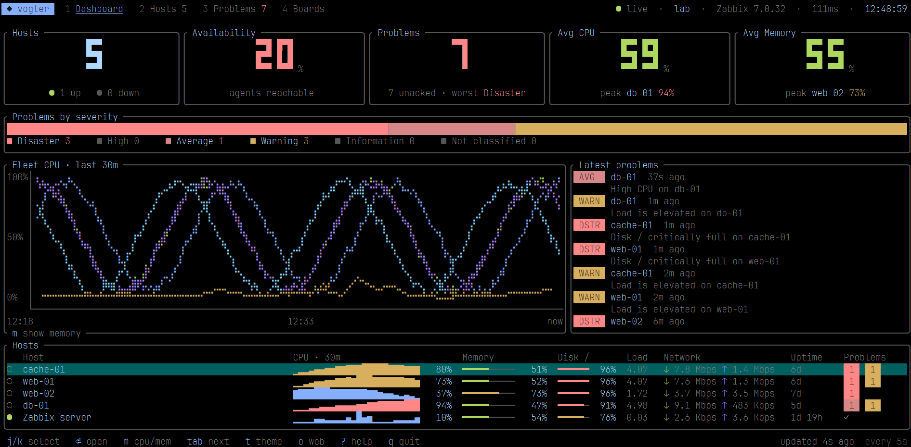

# Vægter

A keyboard-driven terminal UI for **Zabbix**, written in Go: hosts, problems, acknowledgements, graphs and your own
Zabbix dashboards, in a single static binary, with no browser in the loop.



Vægter is an independent port of [zabterm](https://github.com/enderkus/zabterm) by Ender KUŞ. It is not
affiliated with, or endorsed by, the zabterm author. See `NOTICE` and `LICENSE`.

## The name

*Vægter* (`[ˈvεgdʌ]`) is Danish for **watchman**: per
[Den Danske Ordbog](https://ordnet.dk/ddo/ordbog?query=v%C3%A6gter), the guard who kept order in a market town at night,
watched for fire and sang a verse on every stroke of the hour, and today the guard who makes the rounds of a workplace
after hours. Keeping watch through the night and raising the alarm is roughly the job this program does for a Zabbix
estate.

The project's name is Vægter, and that is what the app itself shows. *Vogter* is only the anglicised spelling for
GitHub, which also names the `VOGTER_*` variables and `~/.config/vogter/`. The binary and release files are `vaegter`,
the usual ASCII spelling of æ.

| Danish | English | Notes |
|---|---|---|
| vægter | watchman | the name; from Low German *wachter*, and related to *vagt*, watch |
| vogter | guard, keeper | the spelling used for GitHub, and a Danish word of its own from the same root |

The old job survives in [Ebeltoft](https://www.visitaarhus.com/aarhus/planlegg-reisen/nightwatchmen-old-ebeltoft-gdk606173):
watchmen are recorded there from the late 1600s, and they once patrolled every hour, calling out the time. These days
they set off from the Old Town Hall on summer evenings and stop at restaurants to sing. Vægter patrols every 10 seconds
by default and, sadly, does not sing. It mostly just watches, too: the only changes it makes to Zabbix are an
acknowledgement you ask for and the API token it creates when you connect a server.

## Status

| | Linux | macOS | Windows |
|---|---|---|---|
| Build and unit tests (CI) | ✅ | ✅ | ✅ |
| Run against real Zabbix 7.0.32 in a test lab | ✅ | ❌ not yet tested | ❌ not yet tested |
| Run against a production Zabbix server | ❌ not yet tested | ❌ not yet tested | ❌ not yet tested |

Releases cover Linux on amd64, arm64, armv7, armel, ppc64, mipsel and mips64el, macOS on amd64 and arm64, and Windows
on amd64 and arm64. The Linux builds beyond amd64 pass the tests and run under QEMU, not yet on real hardware.

Every zabterm feature is ported. See `docs/compatibility.md` for what has been verified, what has not, and how Vægter
differs from zabterm.

## Build

Go 1.26 or newer is required.

```sh
make            # gofmt check, go vet, go test -race, then build bin/vaegter
make cross      # dist/ binaries for linux, darwin and windows
make dist       # release binaries and archives, with SHA256SUMS
```

## Use

```sh
bin/vaegter           # first run: a welcome screen connects your server
bin/vaegter setup     # connect another server at any time
bin/vaegter check     # validates the config and tests the server
```

The welcome screen asks for your Zabbix address and login, creates an API token named `vaegter-<hostname>` on your
account, tests it and saves it to `~/.config/vogter/config.toml` (mode 600). Your password is used once and never stored,
and the session is closed afterwards. If your account uses MFA or may not create tokens, press `tab` to paste a token
from User settings → API tokens.

Prefer to write the config by hand? `bin/vaegter init` writes a commented starter file.

Without a config file:

```sh
VOGTER_URL=https://zabbix.example.com VOGTER_TOKEN=... bin/vaegter
```

Coming from zabterm? `bin/vaegter import` copies your config across.

`bin/vaegter licences` prints Vægter's licence and those of the code it includes, so the binary can be shared alone.

Press `5` for the map: OpenStreetMap drawn in the terminal, in braille, Unicode or ASCII. It is off until you
turn it on, because drawing it sends the area you view, and your IP address, to OpenFreeMap and its CDN. Press `e` on
the map screen to try it for one session, or set `enabled = true` under `[map]`. Tiles you have seen are cached, up to
200 MB, so the map also works offline for those areas.

| Keys | On the map |
|---|---|
| `h j k l`, arrows | Pan |
| `+` `-` | Zoom; the mouse wheel zooms too when the mouse is on |
| `:` | Go to a latitude and longitude, such as `55.396, 10.386, 14` |
| `b` | Back to the previous place |
| `f` | Fit every host, or return to the start |
| `v` `P` | Drawing mode, colour palette |
| `y` `L` | Layers, labels |
| `n` `p` `c` | Next or previous host, centre on it |
| `Enter` | Open the selected host |
| `x` `/` | Only hosts with problems, filter by name or group |
| `o` | Open the same place on openstreetmap.org |

Hosts appear where their Zabbix inventory puts them (`location_lat` and `location_lon`, with a decimal point or a
decimal comma), and the map fits itself to them the first time. Markers show health by shape and colour: `●` fine,
`▲` warning or average, `■` high or disaster (pulsing for disaster), `○` unreachable, disabled or in maintenance.
Hosts in one spot merge into a count. A host with no coordinates can be placed in the config instead:

```toml
[profiles.prod.locations]
"web-01" = [55.39594, 10.38621]   # by name or host ID
```

Host locations are read once a minute, and only while the map is on screen. Vægter does not geocode: a host with only
a city in its inventory is counted on the status line but not placed.

Map data © [OpenStreetMap](https://www.openstreetmap.org/copyright) contributors, under the ODbL. Tiles ©
OpenMapTiles, served by [OpenFreeMap](https://openfreemap.org). The palettes are green, amber, blue and cyan phosphor, and solarized dark and light, and
every palette is held to WCAG contrast: 4.5:1 for names, 3:1 for roads and water.

The full map guide, with examples, is in `docs/map.md`.

Press `A` for the About box.

Press `4` for Boards: your Zabbix global dashboards, read-only. Widgets a terminal cannot draw, such as maps, show a
placeholder, and `o` opens the page in Zabbix. See `docs/compatibility.md`.

Options: `-p NAME` picks a profile, `-c PATH` uses another config file, `-t THEME` overrides the theme.

The mouse wheel is off by default, because taking the mouse stops click-and-drag text selection. Set `mouse = true` in
the config, or press `M` while running. Lists scroll with `j k`, page up and down, and `ctrl-d ctrl-u`.

Credentials are tried in this order: `VOGTER_TOKEN`, `token_env`, `token_cmd`, `token`, then
`username`/`password`.

## Environment

| Variable | Effect |
|---|---|
| `VOGTER_URL`, `VOGTER_TOKEN` | Run without a config file; the token overrides the active profile |
| `VOGTER_TRUECOLOR` | `1` forces 24-bit colour, `0` forces 256 colours |
| `VOGTER_ASCII` | `1` uses only ASCII glyphs |
| `NO_COLOR` | Turns colour off, and beats `VOGTER_TRUECOLOR` |

## Zabbix versions

The target is Zabbix 7.0 LTS. Newer versions are supported. 6.4 runs with a warning that it is untested.
Anything older is refused.

## Documentation

- `docs/porting-audit.md`: audit of zabterm and the porting plan
- `docs/architecture.md`
- `docs/compatibility.md`: deliberate differences from zabterm
- `docs/dependencies.md`
- `docs/upstream-pr-notes.md`: fixes to offer upstream
